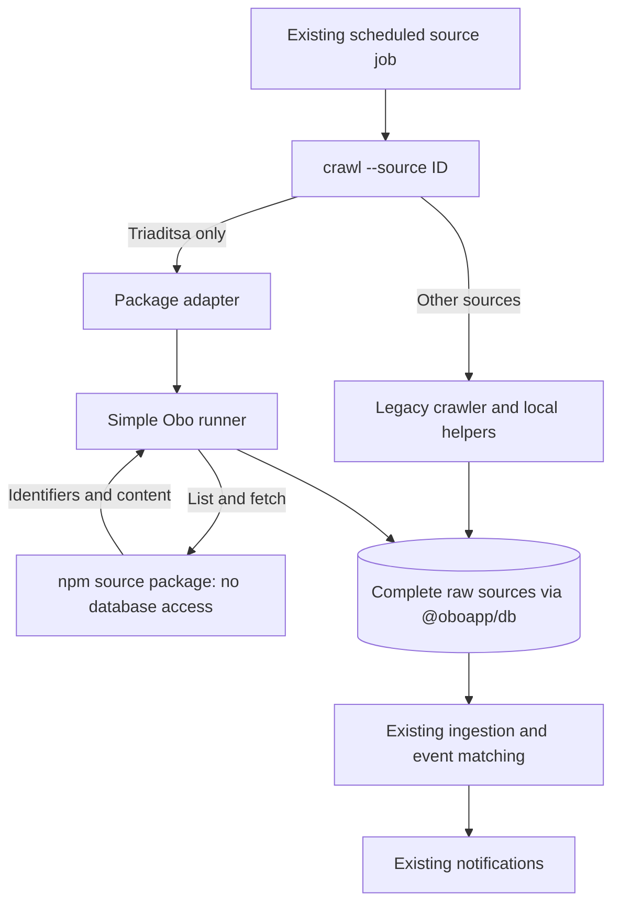

# Source package migration

Tracking: [#586](https://github.com/oboapp/oboapp/issues/586). Packages live in [oboapp/sources](https://github.com/oboapp/sources). Prefer a small, readable integration over infrastructure that has no demonstrated need.

## Current transition state

This describes the `vbuch/oboapp` pilot introduced by [PR #29](https://github.com/vbuch/oboapp/pull/29), not a claim that all upstream sources have migrated. A deployment must include that change before its jobs use the package. The package split is temporary migration architecture; existing collection continues throughout it.

| Responsibility | Legacy sources | Packaged pilot: `triaditsa-org` |
| --- | --- | --- |
| Provider parsing and content conversion | `ingest/crawlers/{id}/` and local helpers | `@oboapp/source-triaditsa-org@0.1.1` in the sources repository |
| Database lookup and raw persistence | Legacy crawler helpers in Obo | `ingest/sources/run-source.ts` in Obo |
| Scheduled entrypoint | Existing `crawl --source {id}` job | Same job and command, with a thin adapter in `crawlers/triaditsa-org/index.ts` |
| Web catalog and deployment selection | Instance source assembly and Terraform | Still the same explicit assembly and Terraform; package installation alone is insufficient |
| Downstream processing | Existing raw-source ingestion, event matching, notifications | The same downstream pipeline |

These paths coexist across different sources. They must not both run for the same source. They also differ from the existing text-versus-precomputed-GeoJSON processing paths: package migration does not change whether a source needs AI or geocoding.

The current image still contains legacy crawler code. Source catalog metadata and Terraform lists are not yet generated from installed packages. The goal of installing only an instance's selected sources remains future work; do not describe the first pilot as completion of that goal.

## Scheduled source runner

`runSource` in `ingest/sources/run-source.ts` receives the database from `getDb()`, package metadata, and a `CreateSource` factory. Load environment variables before obtaining the database. The runner validates `LOCALITY` against the package metadata and creates one source instance for the scan.

The flow is: list candidates, skip identifiers already stored, fetch new content, validate it, and save a complete raw document. Pagination stays in memory within the run. Items are processed sequentially so sources can reuse browser sessions and enforce their provider's rate limits. The source is closed in `finally`.

Historical base64 and MD5 lookups remain supported. Identifiers are preserved byte for byte. A create-only write prevents overlapping scans from overwriting an existing raw record or resetting its processing state. Obo owns source ID, locality, URL, crawl timestamp, and `processed=false`; package content cannot override those fields. Dates and GeoJSON are converted to the existing raw-ingest representation. Invalid content never creates a partial raw record.

An individual lookup, fetch, validation, or save failure is logged and counted while other items continue. The caller receives saved/skipped/failed totals. Listing failures and repeated pagination cursors fail the run. A later scheduled scan starts listing again, skips successful items, and retries missing items that are still available. An item can be missed if it disappears before a successful fetch; this is an accepted limitation of the initial migration.

There is no pending-work collection, persisted cursor, lease, or separate fetch service. `discoverItems` is simply the package operation that lists candidates. `fetchItem` can transform listing payload directly for full-content feeds or synthetic identifiers; it need not make another request.

Triaditsa is the first package pilot. Its existing `triaditsa-org` entrypoint delegates to `@oboapp/source-triaditsa-org` through the runner. The Cloud Run job, schedule, catalog entry, and source identity stay unchanged. Other crawlers retain their existing implementation until their individual cutovers. Preserve each source's special legacy deduplication, including Sofia's title fallback, before switching it. Package upgrades never trigger refetching old identifiers.

## Trying the Triaditsa pilot

With the normal ingest environment configured (`LOCALITY=bg.sofia` and database credentials), run `pnpm --dir ingest crawl --source triaditsa-org`. This is a normal ingestion-source scan: it writes new raw records and logs saved/skipped/failed totals. Existing records should be skipped on a second run. Do not run a second legacy Triaditsa job alongside it.

The source package uses the same RSS Accept header as this deployment fork. Its own tests compare output against a fixture captured from the legacy parser and Markdown conversion. To roll back, revert the pilot switch commit and redeploy the previous entrypoint; no database migration or record deletion is needed.

## Moving the next source

1. Capture its existing identifiers, content, locality, schedule, and special historical lookup rules in contract tests. Preserve fork-specific provider fixes as well as upstream behavior.
2. Extract only provider-facing code into its package, with separate runtime and browser-safe metadata entrypoints. Keep database access in Obo.
3. Publish and verify the reviewed package, then pin its exact version in an Obo integration PR. Replace the existing entrypoint with an adapter and remove the superseded local implementation.
4. Test the actual package-to-raw-document-to-ingestion handoff, known-item skipping, and failures. Keep the same job rather than creating a second scheduled copy.
5. Deploy the integration, inspect the source job's saved/skipped/failed totals, and confirm repeat scans skip known records. Record the migrated source in this guide and update diagrams when the architecture changes.

Parser fixes belong in the source package; runner and ingestion fixes belong in Obo. Package publication and Obo deployment are separate steps. Once legacy collection is retired and selection is unified, remove this transitional wording and replace the two-path diagrams with the final architecture.
