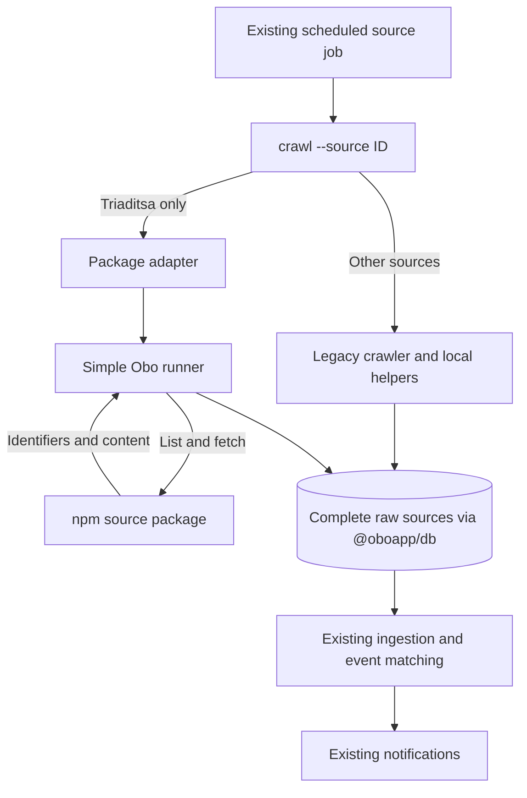

# Source package migration

Tracking: [#586](https://github.com/oboapp/oboapp/issues/586). Packages live in [oboapp/sources](https://github.com/oboapp/sources). Prefer a small, readable integration over infrastructure that has no demonstrated need.

## Current transition state

This describes the `vbuch/oboapp` pilot introduced by [PR #29](https://github.com/vbuch/oboapp/pull/29). Deploying that change switches Triaditsa to its package. Both collection paths remain in use during migration.

| Responsibility | Legacy sources | Packaged pilot: `triaditsa-org` |
| --- | --- | --- |
| Provider parsing and content conversion | `ingest/crawlers/{id}/` and local helpers | `@oboapp/source-triaditsa-org@0.1.1` in the sources repository |
| Database lookup and raw persistence | Legacy crawler helpers in Obo | `ingest/sources/run-source.ts` in Obo |
| Scheduled entrypoint | Existing `crawl --source {id}` job | Same job and command, which calls the package from `crawlers/triaditsa-org/index.ts` |
| Web catalog and deployment selection | Instance source assembly (`shared/src/sources.ts`) and Terraform | The same instance assembly and Terraform configuration |
| Processing after collection | Existing raw-source ingestion, event matching, notifications | The same processing pipeline |

Each source uses one collection path. Text sources continue through AI extraction and geocoding; sources with precomputed GeoJSON use their existing processing path.

The current deployment image includes legacy crawler code. Developers update the source catalog and Terraform lists by hand. A later stage will build these lists from installed packages and include only selected sources in the image.

## Scheduled source runner

`runSource` in `ingest/sources/run-source.ts` receives the database from `getDb()`, package metadata, and a `CreateSource` factory. Load environment variables before obtaining the database. The runner validates `LOCALITY` against the package metadata and creates one source instance for the scan.

The flow is: list candidates, skip identifiers already stored, fetch new content, validate it, and save a complete raw document. Pagination stays in memory within the run. Items are processed sequentially so sources can reuse browser sessions and enforce their provider's rate limits. The source is closed in `finally`.

Historical base64 and MD5 lookups remain supported. Identifiers are preserved byte for byte. A create-only write prevents overlapping scans from overwriting an existing raw record or resetting its processing state. Obo owns source ID, locality, URL, crawl timestamp, and `processed=false`; package content cannot override those fields. Dates and GeoJSON are converted to the existing raw-ingest representation. Invalid content never creates a partial raw record.

An individual lookup, fetch, validation, or save failure is logged and counted while other items continue. The caller receives saved/skipped/failed totals. Listing failures and repeated pagination cursors fail the run. A later scheduled scan starts listing again, skips successful items, and retries missing items that are still available. An item can be missed if it disappears before a successful fetch; this is an accepted limitation of the initial migration.

`discoverItems` lists candidates. `fetchItem` returns their content; full-content feeds and synthetic-identifier sources can supply it directly from the listing payload. The runner handles both operations within the scheduled scan.

Triaditsa is the first package pilot. Its existing `triaditsa-org` entrypoint delegates to `@oboapp/source-triaditsa-org` through the runner. The Cloud Run job, schedule, catalog entry, and source identity stay unchanged. Other crawlers retain their existing implementation until their individual cutovers. Preserve each source's special legacy deduplication, including Sofia's title fallback, before switching it. Package upgrades never trigger refetching old identifiers.

## Trying the Triaditsa pilot

With the normal ingest environment configured (`LOCALITY=bg.sofia` and database credentials), run `pnpm --dir ingest crawl --source triaditsa-org`. This scan writes new raw records and logs saved/skipped/failed totals. Existing records should be skipped on a second run. Use the existing Triaditsa job as the single scheduled entrypoint.

The source package uses the same RSS Accept header as this deployment fork. Its own tests compare output against a fixture captured from the legacy parser and Markdown conversion. To roll back, revert the pilot switch commit and redeploy the previous entrypoint. Existing stored records remain valid.

## Moving the next source

1. Add contract tests for the source's existing identifiers, content, locality, schedule, and historical lookup rules. Include provider fixes made in the deployment fork.
2. Move the code that reads and converts provider data into the package. Provide separate runtime and metadata entrypoints so the web app can load catalog metadata on its own. Keep database access in Obo.
3. Publish and check the reviewed package. Set its exact version in an Obo integration PR. Replace the existing entrypoint with an adapter that calls the package through the runner. Then remove the old local source code.
4. Test the full path from the package through raw storage to ingestion. Check that known items are skipped and failures are handled. Keep the existing scheduled job.
5. Deploy the integration, inspect the source job's saved/skipped/failed totals, and confirm repeat scans skip known records. Record the migrated source in this guide and update diagrams when the architecture changes.

Parser fixes belong in the source package; runner and ingestion fixes belong in Obo. Package publication and Obo deployment are separate steps. Once all sources use packages and share one configuration, update this guide and its diagrams to show the completed migration.
