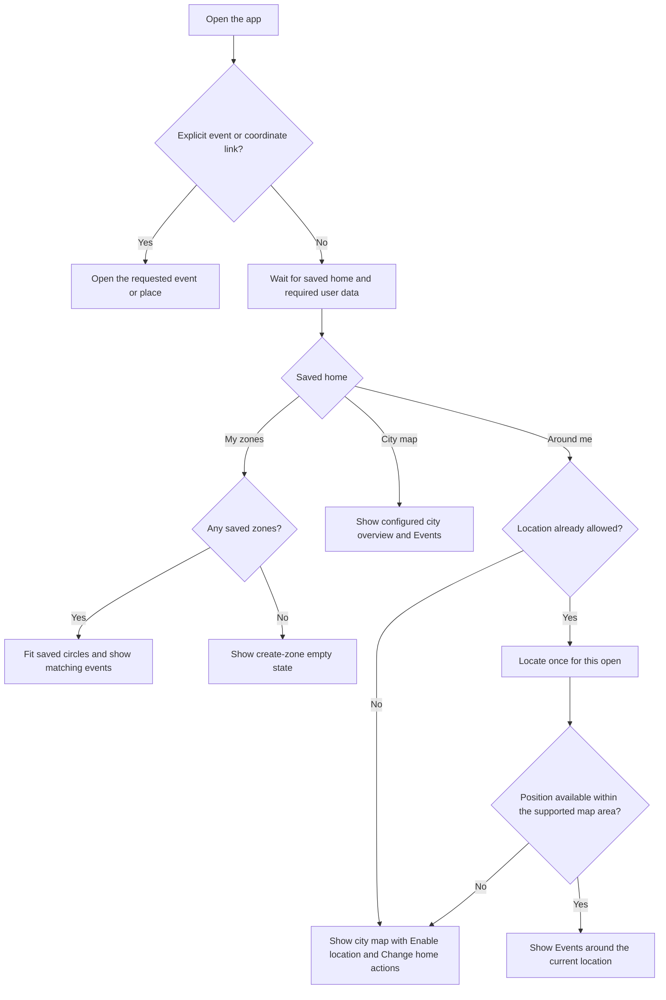
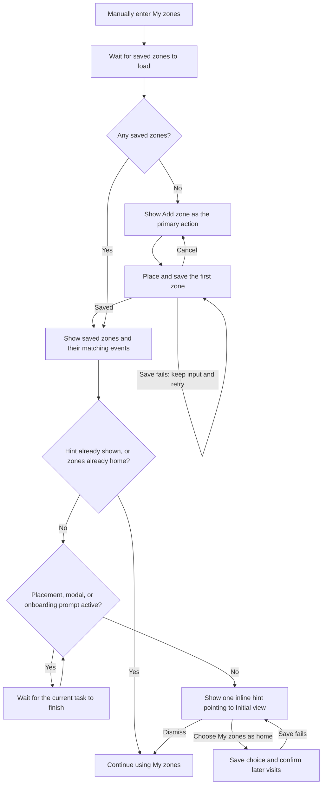
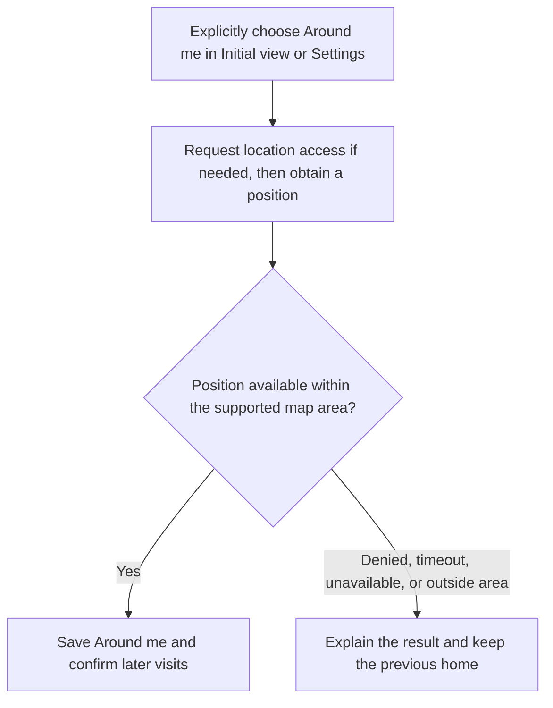
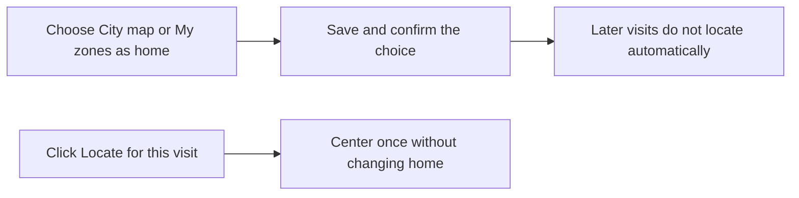

# User Journeys

**Status: Proposed, awaiting UX review.** These home-view journeys extend the
two-choice preference in [PR #44](https://github.com/vbuch/oboapp/pull/44).

## Journey Index

| Journey | Status and detail |
| --- | --- |
| Notification enrollment, guest use, and login | [Current onboarding graph](../features/onboarding-flow.md#state-machine-diagram) |
| Create and manage saved zones | [Current zone creation flow](../features/multi-zone-support.md#zone-creation-flow) |
| Open the app, discover a home view, and control automatic location | Proposed below; [home-view design](home-view-design.md) |

## Open the App

Home has three destinations: **Моите зони**, **Карта на София**, and **Около мен**.
The city label uses the configured locality name. A house icon with the text
**Начален изглед** opens their menu beside the view tabs. Saving a choice confirms
that it applies on later visits and keeps the current view and camera in place.
Temporary tab changes keep the saved home.

Launching the app never opens a location permission prompt. A location failure
uses the city overview for that visit and keeps the saved home. Deleting all
zones also keeps the saved home and opens its create-zone empty state next time.

## Discover My Zones and Choose It as Home

Creating a zone is a goal of its own and can start directly from My zones,
independently of notification enrollment. With no zones, **Добави зона** is the
primary action. The home suggestion appears after a useful zone view is ready.

The hint appears once per device after zones have loaded and at least one exists.
It uses an inline message, so it does not interrupt the current task. It mentions
that the choice can also be changed in Settings. Remember that it was shown so
later visits do not repeat it; a failed save keeps the visible hint available
for retry. An empty view has no home pitch,
but the menu still allows an explicit My zones home choice with no saved zones.

## Choose Current Location as Home

Permission prompts require an explicit click. If access later becomes denied or
needs permission again, startup uses the city map and offers Enable location or
Change home. It waits for a user action before requesting permission.

## Stop Automatic Location and Locate Once

Choosing another home stops future automatic location even if browser location
permission remains granted. Discard any pending automatic location result after
the choice changes. The Locate button stays available for a one-time use.

## Existing Preference Migration

An explicit new choice always wins. Preserve an existing My zones home. For all
other legacy preferences, preserve automatic location when it was previously
enabled; otherwise choose the configured city map. This separates the home
choice from permission to access location.
