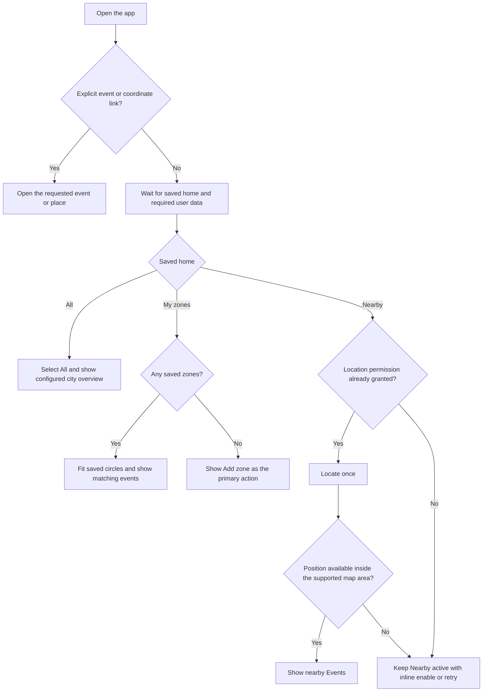
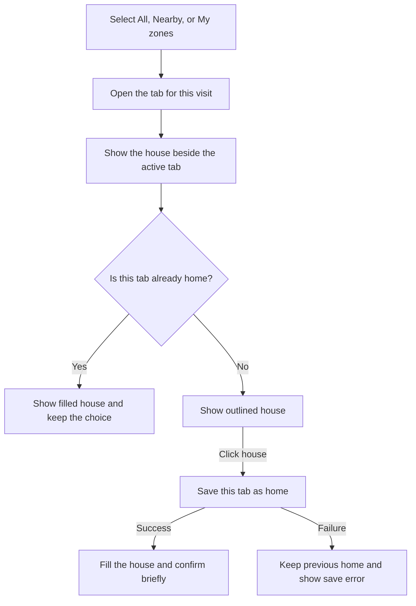
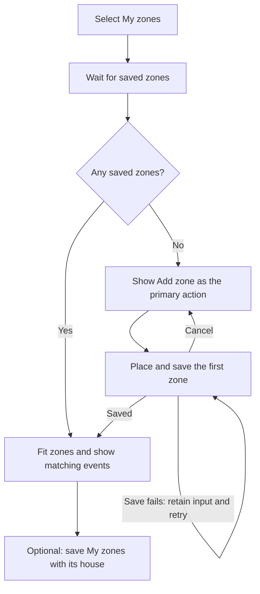
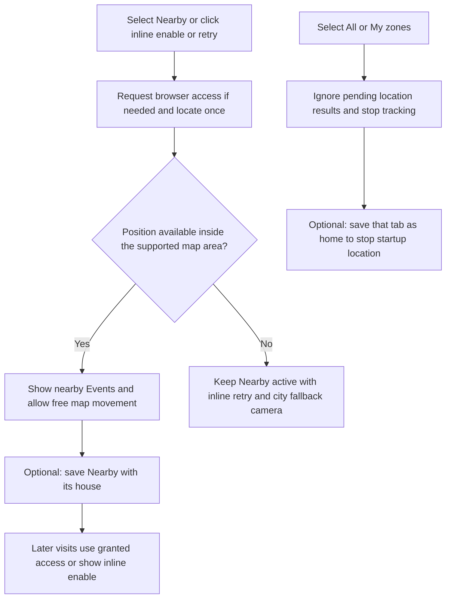

# User Journeys

These journeys describe the three-tab home views in [PR #44](https://github.com/vbuch/oboapp/pull/44).
The [home-view design](home-view-design.md) defines labels, house states, and recovery.

## Journey Index

| Journey | Detail |
| --- | --- |
| Notification enrollment, guest use, and login | [Onboarding graph](../features/onboarding-flow.md#state-machine-diagram) |
| Create and manage saved zones | [Zone creation flow](../features/multi-zone-support.md#zone-creation-flow) |
| Choose a view or save it as home | Below; same behavior on desktop and mobile |

## Open the App

An explicit link takes priority. Otherwise load the saved home, defaulting to
**Всички** for a new user. Location failure keeps Nearby selected with its inline
recovery action. A saved zones home with no zones opens the creation empty state.

Launching the app never opens a permission dialog. Recovery uses the city camera,
hides unrelated event cards, and keeps the saved home. Background updates and
manual map movement leave the chosen camera in place.

## Browse and Save a Home

The active tab carries the house action. A filled house means that tab is home;
an outlined house can save it. Clicking a filled house keeps the current choice.
The tab and house are independent actions even though they share a visual segment.

Tab selection, panning, and zooming leave the saved home intact. Choosing another
tab moves the house to that tab and updates its filled or outlined state.
Settings offers the same home choices as the house action.

## Create the First Zone

Creating a zone is a goal of its own, independent of notification enrollment.
The house stays available as a secondary action while Add zone is primary.

An explicit My zones home is valid with no zones. Deleting the last zone keeps
that choice and opens its creation empty state on the next visit.

## Use Nearby and Stop Automatic Location

Selecting Nearby for a visit leaves the saved home intact. Saving All or My zones
prevents automatic location on later visits even when browser permission remains
granted. Saving Nearby is allowed before access is granted; startup then waits
for an explicit enable action. Re-select Nearby or use inline refresh to relocate.

## Existing Preference Migration

An explicit new choice always wins. Preserve an existing My zones home. For other
returning users, preserve existing automatic location as Nearby; otherwise choose
All. Permission to access location and the saved home remain separate choices.
