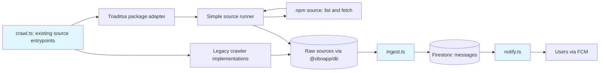

# Ingest Pipeline

Data collection and processing pipeline for OboApp. Collects infrastructure disruption notices from public sources (water, heating, road repairs) across Sofia, processes them into geocoded GeoJSON, and delivers notifications to interested users.

## ⚠️ WORKSPACE SETUP

This package is part of a pnpm workspace. **Run `pnpm install` at the repository root**, not in this directory.

The shared package (@oboapp/shared) is built automatically during workspace installation via postinstall hook.

## Pipeline Overview



During the [source-package transition](../docs/features/source-packages.md), the same command and Cloud Run jobs select either a legacy implementation or a package adapter. Triaditsa is the first packaged source in this fork; the remaining implementations stay in `crawlers/`. These are two collection paths into one downstream pipeline, not duplicate runs of the same source. The package supplies data; Obo's runner owns deduplication, validation, and persistence. No queue or additional scheduler is introduced.

## Components

- **[crawlers/](crawlers/README.md)** - Automated scrapers that fetch raw data from external sources
- **[sources/](sources/run-source.ts)** - Simple scheduled runner for packaged sources; currently used by the Triaditsa entrypoint
- **[messageIngest/](messageIngest/README.md)** - Processing pipeline: AI extraction → geocoding → GeoJSON conversion
- **[geocoding/](geocoding/README.md)** - Geocoding services (Google, Overpass, Cadastre, GTFS) with persistent cache
- **[notifications/](notifications/README.md)** - Geographic matching and push notification delivery

## Usage

```bash
# Run a specific crawler
pnpm crawl --source rayon-oborishte-bg

# Sync GTFS bus stop data
pnpm gtfs-stops

# Process all sources into messages
pnpm ingest

# Send notifications for new messages
pnpm notify

# Run emergent pipeline (emergent crawlers + ingest + notify)
pnpm pipeline:emergent

# Run full pipeline (all crawlers + ingest + notify)
pnpm pipeline:all

# Generate geocoding frequency report (uploads to GCS)
pnpm geocode-cache:report

# Pre-cache a geocoded address/street from an existing message
pnpm geocode-cache:add --message <id> --address "..." --type pin|street

# Export monthly GCP billing costs from BigQuery to GCS (maintainer-only)
pnpm billing-cost:export
pnpm billing-cost:export --months 6 --dry-run  # preview without uploading
```

## Pipeline Schedules

The system runs two automated pipelines via Cloud Scheduler:

- **GTFS Sync** (`gtfs-stops`) - Daily at 3:00 AM EET
  - Downloads latest GTFS static data from Sofia Traffic
  - Updates bus stop coordinates in Firestore
  - Enables geocoding of messages containing bus stop codes

- **Educational Facilities Sync** (`educational-facilities-sync`) - Monthly on the 1st at 4:00 AM EET
  - Downloads schools and kindergartens from Sofia open data (sofiaplan.bg)
  - Updates facility coordinates in database
  - Enables geocoding of messages referencing numbered schools and kindergartens

- **Emergent Pipeline** (`pipeline:emergent`) - Every 30 minutes, 7:00AM-10:30PM
  - Crawlers: Sources that publish short-lived disruptions
  - Runs ingest and notify after crawling
  - Handles short-lived messages and emergency works

- **Full Pipeline** (`pipeline:all`) - 3 times daily (10:00, 14:00, 16:00 EET)
  - Crawlers: All sources
  - Runs ingest and notify after crawling
  - Handles regularly scheduled announcements

## Deployment

Dockerized for Google Cloud Run Jobs. See `Dockerfile` and `terraform/` directory.

## Testing Toolchain Note

Both ingest and web use Vitest 4. Ingest runs with the ESM configuration in `vitest.config.mts`; `vitest.config.ts` re-exports it for compatibility. Use `pnpm --dir ingest test:run` for the normal crawler and pipeline suite.

## AI Prompt Evaluation

The three AI pipeline prompts (filter-split, categorize, extract-locations) are evaluated using [promptfoo](https://www.promptfoo.dev/). Eval configs live in `prompts/__evals__/`.

**Prerequisites:** `GOOGLE_AI_API_KEY` and `GOOGLE_AI_MODEL` env vars must be set (same as for integration tests).
